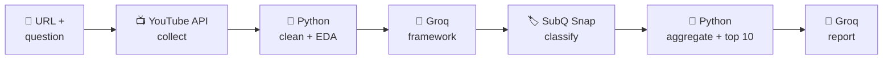

# 🎯 Consensus

**Ask a question about a YouTube video. Get back what its audience actually thinks.**

Consensus is an AI-powered YouTube audience intelligence tool. You give it a
video URL and a research question, for example *"Should I buy the iPhone 18 Pro
or wait for the next model?"*, and it returns a per-comment classification,
aggregated statistics and a written audience report.

**What makes it different from a comment summarizer:** Consensus doesn't just
condense comments. It first builds a **classification framework around your
specific question**, then classifies every top-level comment against it. Ask a
different question about the same video and you get different categories and a
different result.

---

## 📑 Contents

- ⚙️ [How it works](#how-it-works)
- 🚀 [Quick start](#quick-start)
- 🔧 [Configuration](#configuration)
- 💬 [Usage](#usage)
- 📦 [Output artifacts](#output-artifacts)
- 🗂️ [Where data is stored](#where-data-is-stored)
- 🔄 [Resuming interrupted runs](#resuming-interrupted-runs)
- 🔒 [Security](#security)
- 🛠️ [Development](#development)
- 🩺 [Troubleshooting](#troubleshooting)

---

<a id="how-it-works"></a>

## ⚙️ How it works

Each component has a separate responsibility:

| Component | Responsibility |
| --- | --- |
| **YouTube Data API v3** | Collects video details, comments and replies |
| **Python** (with Pandas) | Validation, cleaning, exploratory analysis, aggregation, top-comment selection, persistence |
| **Groq** | Generates the question-specific framework and writes the final report |
| **SubQ Snap** | Classifies each top-level comment against the framework |



### Pipeline

1. 🔎 **Validate.** The URL is checked and the video ID extracted. `watch`,
   `shorts`, `embed`, `live` and `youtu.be` links are accepted. The ID is
   validated before it is used in any API call or file path.
2. 📥 **Collect.** Video title, description, basic analytics and available
   engagement metrics, top-level comments and the replies embedded in each
   comment thread are fetched from the YouTube Data API v3, with bounded
   retries.
3. 💾 **Save raw data.** API responses are written as raw JSON before any
   processing, keeping the original data separate from the cleaned dataset.
4. 🧹 **Clean.** Raw data becomes processed data: normalized text, HTML markup
   removed and zero-width Unicode characters stripped.
   `YouTube API → Raw JSON → Cleaning → Processed JSON`
5. 📈 **Analyse.** Python computes engagement and comment statistics over the
   processed data, including comment and reply activity. They are stored
   separately and later give the report statistical context.
6. 🧠 **Frame.** Groq reads your question, the video title and a sample of
   top-level comments, and generates a classification framework: categories,
   definitions and instructions. Different questions about the same video
   yield different frameworks.
7. 🏷️ **Classify.** SubQ Snap assigns each top-level comment to a category
   from the framework, in [adaptively sized batches](#dynamic-batching) with a
   checkpoint after every successful batch.
8. 📊 **Aggregate.** Python summarises the classifications: total comments
   classified, relevant versus irrelevant counts, and per-category counts and
   percentages.
9. ⭐ **Select top comments.** Python independently picks the ten most-liked
   top-level comments. They are supplementary evidence only, not a replacement
   for the full classification, and likes measure engagement, not necessarily
   agreement.
10. 📝 **Report.** Groq turns the evidence into a concise audience report that
    answers your question, covers dominant patterns and disagreement, uses the
    engagement statistics and top comments, and acknowledges uncertainty and
    dataset limits. It is saved as the fifth artifact.

> 💡 **Population:** only **top-level comments** are classified. Replies
> embedded in each comment thread are counted and reported, but never sent to
> the classifier; full reply traversal is not performed. This keeps the
> methodology consistent across runs.

The **structured outputs** (per-comment classifications and aggregation) are
the systematic record of how the audience sorted against the framework. The
**report** is a written interpretation of that record.

### What each model receives

| Stage | Provider | Input |
| --- | --- | --- |
| Framework | Groq | Research question, video title, up to 40 sampled top-level comments |
| Classification | SubQ Snap | Processed top-level comments, research question, video title, framework categories and instructions, EDA statistics |
| Report | Groq | Research question, video information, framework, aggregated results, EDA statistics, ten most-liked top-level comments with like counts |

Apart from that sample and the ten most-liked comments, no raw comment text is
sent to Groq. The rest of the audience is represented through classification
results and aggregated statistics.

### Dynamic batching

Batch size adapts to the number of pending comments, balancing latency against
token efficiency: small sets avoid batching overhead, large sets cut round-trips.

| Pending comments | Batch size | Comments / request | Questions / request | Total API calls (≈) |
| --- | --- | --- | --- | --- |
| 1–9 | 1 | 1 | 2 | N |
| 10–100 | 4 | 4 | 8 | N / 4 |
| 101+ | 8 | 8 | 16 | N / 8 |

*N is the number of pending comments.* Each comment is classified with **two
questions**, one for relevance and one for stance/category.

- **Checkpointing:** after each successful batch a checkpoint is written to the
  journal (`.jsonl`), so a failure only loses the batch in flight.
- **Resume:** on re-run, completed batches are skipped, and
  `configured_batch_size` is stored in the run metadata and reused for
  consistency.

---

<a id="quick-start"></a>

## 🚀 Quick start

**📋 Requirements**

- Python 3.12+
- [uv](https://docs.astral.sh/uv/) (recommended) or pip
- API keys for YouTube Data API v3, SubQ and Groq

**⬇️ Install**

```bash
# from a source checkout
uv sync

# or install the package
uv pip install .        # or: pip install .
```

This installs the `consensus` console script.

**🔐 Add your keys**

```bash
cp .env.example .env
```

```dotenv
YOUTUBE_API_KEY=...
SUBQ_API_KEY=...
GROQ_API_KEY=...
```

**▶️ Run**

```bash
consensus          # or, from a source checkout: uv run consensus
```

Paste a YouTube URL, type your research question, and wait for the artifacts.

---

<a id="configuration"></a>

## 🔧 Configuration

### 🔑 Credentials

| Variable | Used for |
| --- | --- |
| `YOUTUBE_API_KEY` | Fetching video details and comments |
| `SUBQ_API_KEY` | Comment classification |
| `GROQ_API_KEY` | Framework generation and the final audience report |

Keys are loaded lazily at runtime, so importing the package never requires
credentials. Real environment variables take precedence over values in `.env`.

⚠️ `.env` is ignored by Git. Never commit real keys.

### 📍 Where the `.env` file is read from

| Situation | `.env` location |
| --- | --- |
| `CONSENSUS_ENV_FILE` is set | That file, always |
| Source checkout | `<project>/.env` |
| Installed package | Per-user config directory, e.g. `~/.config/consensus/.env` on Linux |

### 🎛️ Optional overrides

| Variable | Purpose |
| --- | --- |
| `CONSENSUS_DATA_DIR` | Use a custom data directory. Highest priority. |
| `CONSENSUS_ENV_FILE` | Load credentials from a specific `.env` file. |
| `CONSENSUS_LOG_LEVEL` | Logging level, e.g. `INFO` or `DEBUG`. Defaults to `WARNING`. |

---

<a id="usage"></a>

## 💬 Usage

### ⌨️ Command line

```bash
consensus
```

You will be asked for:

1. **A YouTube URL.** `watch`, `shorts`, `embed`, `live` and `youtu.be` links
   are all accepted.
2. **A research question.** Be specific about the decision or opinion you want
   to understand. The framework is built around it.

Different questions for the same video are stored separately and never
overwrite each other.

Example questions (any question works, none have special behaviour):

- *Should I buy this product, or wait for the next model?*
- *Do viewers believe AI will replace software developers?*
- *What are the biggest concerns about this technology?*

### 🖥️ Web interface

A single-page interface lives in [`web/`](web/README.md). It runs the same
unchanged CLI behind a small local Node.js bridge, so the pipeline, storage and
reporting stay exactly as they are.

```bash
node web/server.mjs
```

Then open <http://127.0.0.1:4173>. See [`web/README.md`](web/README.md) for
configuration and routes.

---

<a id="output-artifacts"></a>

## 📦 Output artifacts

For a video `VIDEOID` and question key `KEY`, Consensus writes to
`data/classifications/`:

| File | Contents |
| --- | --- |
| `VIDEOID_KEY.json` | Individual comment classification results |
| `VIDEOID_KEY_aggregation.json` | Aggregated statistics: counts, percentages, relevant/irrelevant totals |
| `VIDEOID_KEY_framework.json` | The Groq-generated classification framework |
| `VIDEOID_KEY_run_metadata.json` | Run signature, model settings, `configured_batch_size`, token and request metrics |
| `VIDEOID_KEY_report.json` | Groq audience report, research question, model and classification run signature |
| `VIDEOID_KEY_<signature>.jsonl` | Append-only checkpoint journal (`<signature>` is the first 12 characters of the run signature) |

The first four are produced by the classification stage. The report is the
fifth artifact, generated afterwards. The journal is working state used for
[resuming](#resuming-interrupted-runs).

---

<a id="where-data-is-stored"></a>

## 🗂️ Where data is stored

| Situation | Data directory |
| --- | --- |
| `CONSENSUS_DATA_DIR` is set | That directory, always |
| Source checkout | `<project>/data` |
| Installed package, Linux | `~/.local/share/consensus` |
| Installed package, macOS | `~/Library/Application Support/consensus` |
| Installed package, Windows | `%LOCALAPPDATA%\consensus` |

```text
data/
├── raw/              original YouTube API responses, preserved before cleaning
├── processed/        cleaned comment records
├── analysis/         Python EDA and engagement statistics
└── classifications/  results, aggregation, framework, metadata, report, checkpoints, archive
```

---

<a id="resuming-interrupted-runs"></a>

## 🔄 Resuming interrupted runs

A run resumes automatically when **all** of the following match the saved run
signature:

- video
- research question
- comment set
- framework
- prompts
- models
- classification settings

**How it behaves:**

1. 💾 A checkpoint is appended to the JSONL journal after every successful
   batch.
2. ❌ If a later batch fails, completed batches stay checkpointed and the run
   exits with a clear error.
3. 🔁 Re-run the same video and question. Completed batches are skipped, so
   they aren't classified (or paid for) again, and the stored
   `configured_batch_size` is reused for consistency.
4. 🗄️ If any input above **changes** for the same question, the previous
   artifacts are archived (hash-verified copy) under
   `data/classifications/archive/` before the new run writes its files.

---

<a id="security"></a>

## 🔒 Security

- 🔑 API keys are loaded lazily and redacted from error messages. `.env` is
  ignored by Git.
- 🆔 YouTube video IDs are validated before they are used in file paths or API
  calls.
- 🖥️ Terminal control characters are stripped from untrusted comment text.
- 🧱 Comment text is passed to models as quoted, untrusted data, with explicit
  instructions not to follow instructions found inside comments.
- 📝 The report receives only the ten most-liked top-level comments as raw
  text; framework generation receives a small sample of comments.

> ⚠️ These measures reduce prompt-injection risk but can't eliminate it.

---

<a id="development"></a>

## 🛠️ Development

```bash
uv sync --group dev
uv run pytest
```

🧪 Tests mock all providers and never make paid API requests.

---

<a id="troubleshooting"></a>

## 🩺 Troubleshooting

| Symptom | What to check |
| --- | --- |
| Error about a missing API key | Confirm all three keys are set in the `.env` file Consensus is reading (see [Configuration](#configuration)), or exported as environment variables. |
| Video or comments can't be fetched | Check `YOUTUBE_API_KEY`, that YouTube Data API v3 is enabled for it, and your daily quota in the Google Cloud console. |
| Framework or report generation fails | Check `GROQ_API_KEY` and your Groq limits, then re-run the same video and question. |
| Run stops partway with a batch error | Check `SUBQ_API_KEY` and your SubQ limits, then re-run with the same video and question. Completed batches are checkpointed and the run resumes. |
| Run starts from scratch unexpectedly | Something in the run signature changed (comment set, framework, prompts, models or settings). The previous artifacts were archived, not lost. |
| Can't find your output files | Check which data directory is active (see [Where data is stored](#where-data-is-stored)). |
| Web interface won't load | Make sure Node.js is installed, `node web/server.mjs` is running and you're on <http://127.0.0.1:4173>. The bridge runs the CLI, so keys must be configured too. See [`web/README.md`](web/README.md). |