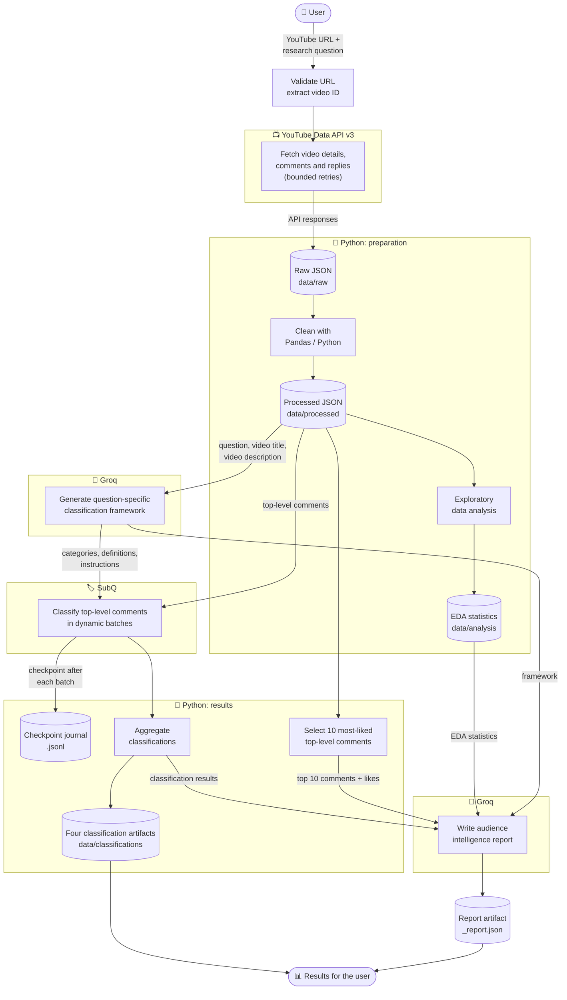

# 🎯 Consensus

**Ask a question about a YouTube video. Get back what its audience actually thinks.**

Consensus is an AI-powered YouTube audience intelligence tool. You give it a
video URL and a research question, for example *"Should I buy the iPhone 18 Pro
or wait for the next model?"*, and it returns a structured, per-comment
classification, aggregated statistics and a written audience report.

**What makes it different from a comment summarizer:** Consensus doesn't just
condense comments. It first builds a **classification framework around your
specific question**, then systematically classifies every top-level comment
against it. Ask a different question about the same video and you get a
different framework, different categories and a different result.

---

## 📑 Contents

- ⚙️ [How it works](#how-it-works)
- 🚀 [Quick start](#quick-start)
- 🔧 [Configuration](#configuration)
- 💬 [Usage](#usage)
- 📦 [Output artifacts](#output-artifacts)
- 🗂️ [Where data is stored](#where-data-is-stored)
- 🔄 [Resuming interrupted runs](#resuming-interrupted-runs)
- 🔒 [Security](#security)
- 🛠️ [Development](#development)
- 🩺 [Troubleshooting](#troubleshooting)

---

<a id="how-it-works"></a>

## ⚙️ How it works

### Architecture

Each component has a clearly separated responsibility:

| Component | Responsibility |
| --- | --- |
| **YouTube Data API v3** | Data collection: video details, comments and replies |
| **Python** (with Pandas) | Validation, cleaning, exploratory analysis, aggregation, top-comment selection and persistence |
| **Groq** | Generating the question-specific classification framework, and writing the final audience report |
| **SubQ** | Classifying each top-level comment against the generated framework |



### Pipeline walkthrough

1. 🔎 **Validate input.** The URL is validated and the video ID extracted.
   `watch`, `shorts`, `embed`, `live` and `youtu.be` links are accepted. The
   ID is validated before it is used in any API call or file path.
2. 📥 **Collect.** Consensus uses the YouTube Data API v3 to fetch the video's
   title, description, basic analytics and available engagement metrics,
   top-level comments and replies, with bounded retries.
3. 💾 **Save raw data.** The API responses are written as raw JSON before any
   processing, so the originally collected data always stays separate from the
   cleaned dataset.
4. 🧹 **Clean.** Raw data is turned into processed data: cleaned comment
   records with normalized text, unwanted HTML markup removed and zero-width
   Unicode characters stripped.
   `YouTube API → Raw JSON → Cleaning → Processed JSON`
5. 📈 **Analyse.** Python computes engagement and comment statistics over the
   processed dataset (including comment and reply activity) to understand the
   dataset's structure and provide statistical context for the final report.
   Results are stored separately from raw and processed data.
6. 🧠 **Frame.** Groq receives your research question, the video title and the
   video description, and generates a classification framework tailored to
   that question: categories, definitions and classification instructions.
   Groq decides which categories matter for your objective, so different
   questions about the same video produce different frameworks.
7. 🏷️ **Classify.** SubQ receives the processed top-level comments, the
   framework's categories and the classification instructions, and assigns
   each comment to a category. Requests are sent in dynamically sized batches
   (see [below](#dynamic-batching)), and a checkpoint is appended after every
   successful batch.
8. 📊 **Aggregate.** Python turns the individual classifications into summary
   statistics: total comments classified, relevant versus irrelevant counts,
   and per-category counts and percentages.
9. ⭐ **Select top comments.** Python independently picks the ten most-liked
   top-level comments by like count. They're supplementary qualitative
   evidence only, never a replacement for the full classification. Likes
   measure engagement, not necessarily agreement or approval.
10. 📝 **Narrate.** Groq receives the evidence package (see
    [What each model receives](#what-each-model-receives)) and writes a
    concise, natural-language audience intelligence report, saved as the fifth
    artifact.

> 💡 **Population:** only **top-level comments** are classified. Replies are
> collected, counted and reported, but never sent to the classifier. This keeps
> the methodology consistent across runs.

### Dynamic batching

To keep each request a manageable size and avoid unnecessary token
consumption, the batch size depends on how many comments need classifying:

| Number of comments | Strategy |
| --- | --- |
| 1–10 | No batching; classified individually |
| 11–100 | Batches of 10 |
| Above 100 | Batches of 20 |

<!-- VERIFY against the classifier source: exact thresholds and boundary behaviour. -->

Batching ties directly into reliability: each successful batch is checkpointed,
so a failure part-way through only costs you the batch in flight. See
[Resuming interrupted runs](#resuming-interrupted-runs).

### What each model receives

| Stage | Provider | Input |
| --- | --- | --- |
| Framework generation | Groq | Research question, video title, video description |
| Comment classification | SubQ | Processed top-level comments, framework categories, classification instructions |
| Final report | Groq | Research question, video information, framework, aggregated classification results, EDA statistics, and the ten most-liked top-level comments with their like counts |

No other raw comment text is sent to Groq for reporting. The rest of the
audience is represented through classification results and aggregated
statistics.

### What the final report does

The report directly addresses your original question and explains the overall
audience response. It highlights dominant patterns, discusses disagreement and
contrasting viewpoints where present, works in relevant engagement statistics,
uses the most-liked comments as supporting evidence, and acknowledges
uncertainty and dataset limitations rather than drawing unsupported
conclusions.

### What you get

| Output | Nature |
| --- | --- |
| Video information and basic analytics | Collected data |
| Individual comment classifications | Structured |
| Aggregated distribution, with relevant and irrelevant counts | Structured |
| Engagement analysis and the ten most-liked comments | Statistical / evidence |
| Audience intelligence report | Narrative, AI-written |

The **structured outputs** are the systematic, per-comment record of how the
audience sorted against the framework. The **report** is an interpretation of
that record, written for a human reader.

---

<a id="quick-start"></a>

## 🚀 Quick start

**📋 Requirements**

- Python 3.12+
- [uv](https://docs.astral.sh/uv/) (recommended) or pip
- API keys for YouTube Data API v3, SubQ and Groq

**⬇️ Install**

```bash
# from a source checkout
uv sync

# or install the package
uv pip install .        # or: pip install .
```

This installs the `consensus` console script (the pipeline).

**🔐 Add your keys**

```bash
cp .env.example .env
```

```dotenv
YOUTUBE_API_KEY=...
SUBQ_API_KEY=...
GROQ_API_KEY=...
```

**▶️ Run**

```bash
consensus

# from a source checkout without activating the environment
uv run consensus
```

Paste a YouTube URL, type your research question, and wait for the artifacts.

---

<a id="configuration"></a>

## 🔧 Configuration

### 🔑 Credentials

| Variable | Used for |
| --- | --- |
| `YOUTUBE_API_KEY` | Fetching video details and comments |
| `SUBQ_API_KEY` | Comment classification |
| `GROQ_API_KEY` | Framework generation and the final audience report |

Keys are loaded lazily at runtime, so importing the package never requires
credentials. Real environment variables take precedence over values in `.env`.

⚠️ `.env` is ignored by Git. Never commit real keys.

**📍 Where the `.env` file is read from**

| How you run Consensus | Default location |
| --- | --- |
| Source checkout | `<project>/.env` |
| Installed package | Per-user config directory, e.g. `~/.config/consensus/.env` on Linux |
| `CONSENSUS_ENV_FILE` set | That file, always |

### 🎛️ Optional overrides

| Variable | Purpose |
| --- | --- |
| `CONSENSUS_DATA_DIR` | Use a custom data directory. Highest priority. |
| `CONSENSUS_ENV_FILE` | Load credentials from a specific `.env` file. |
| `CONSENSUS_LOG_LEVEL` | Set the logging level, e.g. `INFO` or `DEBUG`. Defaults to `WARNING`. |

---

<a id="usage"></a>

## 💬 Usage

### ⌨️ Command line

```bash
consensus
```

You will be asked for:

1. **A YouTube URL.** `watch`, `shorts`, `embed`, `live` and `youtu.be` links
   are all accepted.
2. **A research question.** Be specific about the decision or opinion you want
   to understand. The framework is built around it.

Different questions for the same video are stored separately and never
overwrite each other, so you can ask as many as you like.

Example research questions (all user-defined; none have special built-in
behaviour):

- *Should I buy this product, or wait for the next model?*
- *Do viewers believe AI will replace software developers?*
- *Are users satisfied with this product?*
- *What are the biggest concerns about this technology?*
- *Do viewers prefer one approach over the other?*

### 🖥️ Web interface

A single-page interface lives in [`web/`](web/README.md). It runs the same
unchanged CLI behind a small local Node.js bridge, so the pipeline, storage and
reporting stay exactly as they are.

```bash
node web/server.mjs
```

Then open <http://127.0.0.1:4173>. See [`web/README.md`](web/README.md) for
configuration and routes.

---

<a id="output-artifacts"></a>

## 📦 Output artifacts

For a video `VIDEOID` and question key `KEY`, Consensus writes to
`data/classifications/`:

| File | Contents |
| --- | --- |
| `VIDEOID_KEY.json` | Individual comment classification results |
| `VIDEOID_KEY_aggregation.json` | Aggregated classification statistics (counts, percentages, relevant/irrelevant totals) |
| `VIDEOID_KEY_framework.json` | The Groq-generated classification framework |
| `VIDEOID_KEY_run_metadata.json` | Run signature, model settings, token and request metrics |
| `VIDEOID_KEY_report.json` | Groq audience report, research question, model and classification run signature |
| `VIDEOID_KEY_<signature>.jsonl` | Append-only checkpoint journal |

The first four are written once classification completes; the report is the
fifth artifact, generated afterwards from those results. The journal is working
state used for [resuming](#resuming-interrupted-runs).

---

<a id="where-data-is-stored"></a>

## 🗂️ Where data is stored

| How you run Consensus | Data directory |
| --- | --- |
| `CONSENSUS_DATA_DIR` set | That directory, always |
| Source checkout | `<project>/data` |
| Installed package, Linux | `~/.local/share/consensus` |
| Installed package, macOS | `~/Library/Application Support/consensus` |
| Installed package, Windows | `%LOCALAPPDATA%\consensus` |

```text
data/
├── raw/              original YouTube API responses, preserved before cleaning
├── processed/        cleaned comment records
├── analysis/         Python EDA and engagement statistics
└── classifications/  results, aggregation, framework, metadata, report, checkpoints
```

---

<a id="resuming-interrupted-runs"></a>

## 🔄 Resuming interrupted runs

Classification is the slowest and most expensive stage, so Consensus is built
so that an interruption doesn't waste completed work.

A run resumes automatically when **all** of the following match the saved run
signature:

- video
- research question
- comment set
- framework
- prompts
- models
- classification settings

**How it behaves:**

1. 💾 A checkpoint is appended to the JSONL journal after every successful
   classification batch.
2. ❌ If a later batch fails, the batches already completed stay checkpointed
   and the run exits with a clear error.
3. 🔁 Re-run the same video and question. Completed batches are reused rather
   than classified again, which avoids repeating classification API requests.
4. 🗄️ If any of the inputs above **change** for the same question, the
   previous artifacts are archived (hash-verified copy) before the new run
   writes its files. Nothing is silently overwritten.

---

<a id="security"></a>

## 🔒 Security

- 🔑 API keys are loaded lazily and redacted from error messages. `.env` is
  ignored by Git.
- 🆔 YouTube video IDs are validated before they are used in file paths or API
  calls.
- 🖥️ Terminal control characters are stripped from untrusted comment text.
- 🧱 Comment text is passed to models as quoted, untrusted data, with explicit
  instructions not to follow instructions found inside comments.
- 📝 The final audience report receives classified results, EDA statistics, the
  ten most-liked top-level comments (text and likes) as supplementary evidence,
  and your question. No other raw comment text is sent to Groq for reporting.

> ⚠️ These measures reduce prompt-injection risk but can't eliminate it. Treat
> model output derived from public comments as untrusted.

---

<a id="development"></a>

## 🛠️ Development

```bash
uv sync --group dev
uv run pytest
```

🧪 Tests mock all external providers and never make paid API requests, so the
suite validates the project's behaviour without needing real keys or spending
quota.

---

<a id="troubleshooting"></a>

## 🩺 Troubleshooting

| Symptom | What to check |
| --- | --- |
| Error about a missing API key | Confirm all three keys are set in the `.env` file Consensus is reading (see [Configuration](#configuration)), or exported as environment variables. |
| Video details or comments can't be fetched | Check `YOUTUBE_API_KEY` and that the YouTube Data API v3 is enabled for it. The API has a daily quota, which you can check in your Google Cloud console. Collection uses bounded retries, so a persistent failure ends the run with an error. |
| Framework or report generation fails | Check `GROQ_API_KEY` and your Groq account's availability and limits, then re-run the same video and question. |
| Run stops partway with a batch error | Check `SUBQ_API_KEY` and your SubQ limits, then re-run with the same video and question. Completed batches are checkpointed and the run resumes. |
| Run starts from scratch unexpectedly | Something in the run signature changed (comment set, framework, prompts, models or settings), for example because the video received new comments. The previous artifacts were archived, not lost. |
| Can't find your output files | Check which data directory is active (see [Where data is stored](#where-data-is-stored)). Look in `classifications/` for results, report and metadata. |
| Wrong `.env` is being read | See [Where the `.env` file is read from](#configuration), or point to a file explicitly with `CONSENSUS_ENV_FILE`. |
| Web interface won't start or load | Make sure Node.js is installed, you're running `node web/server.mjs`, and you're opening <http://127.0.0.1:4173>. The bridge runs the same CLI, so keys must be configured as above. See [`web/README.md`](web/README.md). |
| Need more detail on what happened | Set `CONSENSUS_LOG_LEVEL=INFO` or `DEBUG` and re-run. |