# 🎯 Consensus

**Ask a question about a YouTube video. Get back what its audience actually thinks.**

Consensus collects a video's comments, cleans and analyses them, then uses an
LLM-generated framework to classify every **top-level comment** against *your*
research question, for example *"Should I buy the iPhone 18 Pro or wait for the
next model?"*. The result is a per-comment classification plus an aggregated
view of where the audience stands.

---

## 📑 Contents

- ⚙️ [How it works](#how-it-works)
- 🚀 [Quick start](#quick-start)
- 🔧 [Configuration](#configuration)
- 💬 [Usage](#usage)
- 📦 [Output artifacts](#output-artifacts)
- 🔄 [Resuming interrupted runs](#resuming-interrupted-runs)
- 🗂️ [Where data is stored](#where-data-is-stored)
- 🚚 [Migrating existing data](#migrating-existing-data)
- 🛠️ [Development](#development)
- 🔒 [Security](#security)
- 🩺 [Troubleshooting](#troubleshooting)

---

<a id="how-it-works"></a>

## ⚙️ How it works

```mermaid
flowchart LR
    A[YouTube URL<br/>+ research question] --> B[Validate video ID]
    B --> C[Fetch details<br/>and comments]
    C --> D[Save raw data]
    D --> E[Clean comments]
    E --> F[Engagement<br/>statistics]
    F --> G[Generate question-specific<br/>framework]
    G --> H[Classify top-level<br/>comments in batches]
    H --> I[Write four<br/>artifacts]
    I --> J[Generate Groq<br/>audience report]
    J --> K[Write report<br/>artifact]
```



1. 📥 **Collect:** fetches video details and comments from the YouTube Data API
   v3, with bounded retries.
2. 🧹 **Prepare:** saves the raw responses, cleans the comments and computes
   engagement statistics.
3. 🧠 **Frame:** generates a classification framework tailored to your question
   (categories, definitions and instructions) using an LLM.
4. 🏷️ **Classify:** assigns each top-level comment to a category, checkpointing
   after every successful batch.
5. 📊 **Report:** writes individual results, an aggregation summary, the
   framework and run metadata.
6. 📝 **Narrate:** generates a concise, natural-language analysis from the
   classified results, EDA and your question, then saves it as the fifth
   artifact.

> 💡 **Population:** only **top-level comments** are classified. Replies are
> collected, counted and reported, but never sent to the classifier. This keeps
> the methodology consistent across runs.

---

<a id="quick-start"></a>

## 🚀 Quick start

**📋 Requirements**

- Python 3.12+
- [uv](https://docs.astral.sh/uv/) (recommended) or pip
- API keys for YouTube Data API v3, SubQ and Groq

**⬇️ Install**

```bash
# from a source checkout
uv sync

# or install the package
uv pip install .        # or: pip install .
```

This installs two console scripts: `consensus` (the pipeline) and
`consensus-migrate` (a data-migration helper).

**🔐 Add your keys**

```bash
cp .env.example .env
```

```dotenv
YOUTUBE_API_KEY=...
SUBQ_API_KEY=...
GROQ_API_KEY=...
```

**▶️ Run**

```bash
consensus
```

Paste a YouTube URL, type your research question, and wait for the artifacts.

---

<a id="configuration"></a>

## 🔧 Configuration

### 🔑 Credentials

| Variable | Used for |
| --- | --- |
| `YOUTUBE_API_KEY` | Fetching video details and comments |
| `SUBQ_API_KEY` | Comment classification |
| `GROQ_API_KEY` | Framework generation and the final audience report |

Keys are loaded lazily at runtime, so importing the package never requires
credentials. Real environment variables take precedence over values in `.env`.

⚠️ `.env` is ignored by Git. Never commit real keys.

**📍 Where the `.env` file is read from**

| How you run Consensus | Default location |
| --- | --- |
| Source checkout | `<project>/.env` |
| Installed package | Per-user config directory, e.g. `~/.config/consensus/.env` on Linux |
| `CONSENSUS_ENV_FILE` set | That file, always |

### 🎛️ Optional overrides

| Variable | Purpose |
| --- | --- |
| `CONSENSUS_DATA_DIR` | Use a custom data directory. Highest priority. |
| `CONSENSUS_ENV_FILE` | Load credentials from a specific `.env` file. |
| `CONSENSUS_LOG_LEVEL` | Set the logging level, e.g. `INFO` or `DEBUG`. Defaults to `WARNING`. |

---

<a id="usage"></a>

## 💬 Usage

```bash
consensus
```

You will be asked for:

1. **A YouTube URL.** `watch`, `shorts`, `embed`, `live` and `youtu.be` links
   are all accepted.
2. **A research question.** Be specific about the decision or opinion you want
   to understand. The framework is built around it.

Different questions for the same video are stored separately and never
overwrite each other, so you can ask as many as you like.

### 🖥️ Web interface

A single-page interface lives in [`web/`](web/README.md). It runs the same
unchanged CLI behind a small local Node bridge, so the pipeline, storage and
reporting stay exactly as they are.

```bash
node web/server.mjs
```

Then open <http://127.0.0.1:4173>. See [`web/README.md`](web/README.md) for
configuration and routes.

---

<a id="output-artifacts"></a>

## 📦 Output artifacts

For a video `VIDEOID` and question key `KEY`, Consensus writes to
`data/classifications/`:

| File | Contents |
| --- | --- |
| `VIDEOID_KEY.json` | Individual classification results |
| `VIDEOID_KEY_aggregation.json` | Aggregation summary |
| `VIDEOID_KEY_framework.json` | The generated classification framework |
| `VIDEOID_KEY_run_metadata.json` | Run signature, model settings, token and request metrics |
| `VIDEOID_KEY_report.json` | Groq audience report, research question, model and classification run signature |
| `VIDEOID_KEY_<signature>.jsonl` | Append-only checkpoint journal |

---

<a id="resuming-interrupted-runs"></a>

## 🔄 Resuming interrupted runs

Runs resume automatically when **all** of the following match the saved run
signature:

- video
- research question
- comment set
- framework
- prompts
- models
- classification settings

**How it behaves:**

- 💾 A checkpoint is appended to the journal after every successful batch, so an
  interrupted run keeps its completed work.
- ❌ If a batch fails, successful batches stay checkpointed and the run exits with
  a clear error. Re-run the same question to resume from the journal.
- 🗄️ If the inputs for the same question **change**, the previous artifacts are
  archived (hash-verified copy) before the new run writes its files.

---

<a id="where-data-is-stored"></a>

## 🗂️ Where data is stored

| How you run Consensus | Data directory |
| --- | --- |
| `CONSENSUS_DATA_DIR` set | That directory, always |
| Source checkout | `<project>/data` |
| Installed package, Linux | `~/.local/share/consensus` |
| Installed package, macOS | `~/Library/Application Support/consensus` |
| Installed package, Windows | `%LOCALAPPDATA%\consensus` |

```text
data/
  raw/              raw YouTube API responses
  processed/        cleaned comments
  analysis/         engagement statistics
  classifications/  results, aggregation, framework, metadata, report, checkpoints
```

---

<a id="migrating-existing-data"></a>

## 🚚 Migrating existing data

If you previously stored data inside `src/consensus/data`, copy it with the
migration helper:

```bash
consensus-migrate --dry-run   # show what would be copied
consensus-migrate             # copy with hash verification
```

Use `--source` and `--target` to migrate between custom locations, and
`consensus-migrate --help` for all options.

**🛡️ Safety guarantees**

- ✅ Existing target files are never overwritten.
- ✅ Identical files are skipped.
- ✅ Conflicting files are reported, not replaced.
- ✅ Source files are never deleted.
- ✅ Every copied file is hash-verified.

---

<a id="development"></a>

## 🛠️ Development

```bash
uv sync --group dev
uv run pytest
```

🧪 Tests mock all providers and never make paid API requests.

---

<a id="security"></a>

## 🔒 Security

- 🔑 API keys are read lazily and redacted from error messages.
- 🆔 YouTube video IDs are validated before they are used in file paths or API
  calls.
- 🖥️ Terminal control characters are stripped from untrusted comment text.
- 🧱 Comment text is passed to models as quoted, untrusted data, with explicit
  instructions not to follow instructions found inside comments.
- 📝 The final audience report receives classified results, EDA statistics, the
  ten most-liked top-level comments (text and likes) as supplementary evidence,
  and your question. No other raw comment text is sent to Groq for reporting.

---

<a id="troubleshooting"></a>

## 🩺 Troubleshooting

| Symptom | What to check |
| --- | --- |
| Error about a missing API key | Confirm all three keys are set in the `.env` file Consensus is reading (see [Configuration](#configuration)), or exported as environment variables. |
| Run stops partway with a batch error | Re-run with the same video and question. Completed batches are checkpointed and the run resumes. |
| Run starts from scratch unexpectedly | Something in the run signature changed (comment set, prompts, models or settings). The previous artifacts were archived, not lost. |
| Can't find your output files | Check which data directory is active (see [Where data is stored](#where-data-is-stored)). |
| Old data missing after upgrading | Run `consensus-migrate --dry-run`, then `consensus-migrate`. |